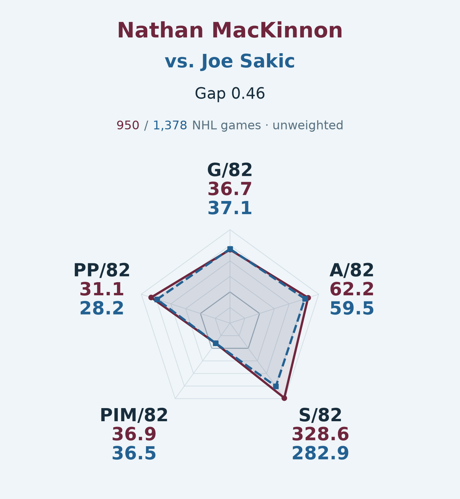

# Avalanche career comparisons

Which former Avalanche players have NHL careers most similar to the current roster?
This project reproduces the figures and analysis behind Anthony's Avalanche article.

**The primary model compares full observed careers using five rate statistics. Career
games are displayed as sample-size context and carry no similarity weight.** A separate
same-age supplement is included. Missing PK minutes never exclude an otherwise eligible
comparison player.

Start with the [current figures](figures/revision-v2/README.md),
[method and weights](docs/revised-method.md), or [data sources](docs/sources.md).



## Reproduce the primary article

From the repository root, with Python 3.11 or newer and [uv](https://docs.astral.sh/uv/):

```sh
uv sync --locked --group analysis --group dev
uv run --locked --group analysis python -m avalanche_career_comps.feedback_analysis \
  --out local/article
```

Open `local/article/article-preview.html` for the paired-image reading order. No database,
credentials or downloads are needed. The command recomputes both career windows, the
Cale comparison and the Forsberg search from the included normalized season records.
Use a fresh destination; nonempty directories are protected from overwriting.

The output includes phone-readable individual charts, two-panel alternatives, a
1200×675 preview, `alt-text.csv`, article explanations, raw results, a change ledger,
controlled sensitivities and a checksum manifest. Full-career figures are primary;
`age-adjusted/` is a separately labeled supplement with an example shown in the reading preview.

## What the current model measures

The roster was collected on **November 10, 2026**, with NHL regular-season statistics
through completed **2025–26**. Skater alumni need **82 Colorado appearances**; goalies
need **50**. Once eligible, their NHL careers across all teams count. Forwards,
defensemen and goalies are compared separately. The Forsberg reverse search intentionally
allows both current and former Avs. NHL IDs identify players; names are display labels.

Skaters use era-adjusted goals, assists, shots and PP points per 82 games, plus unadjusted
PIM/82. Their weights are **25%, 25%, 21.4%, 14.3% and 14.3%**, respectively. GP is context,
not a spoke or part of the score. PK could receive 10% only when the entire eligible pool
and target have complete audited records and the target averages at least one PK minute
per game; none of the full-career skater comparisons meets that full-pool condition.

The historical pool remains intact: Makar and Burns each retain all **45** eligible
former defensemen. Makar matches **Bourque**, and Burns matches **Ozolinsh**. The Cale
roster chart and special overlay use the same matching statistics and name the same
nearest player. Makar's distance is **1.401108**, versus the alumni median nearest-match
distance **0.272958**, giving **5.133×**. That ratio measures distance, not difficulty,
quality, a probability or NHL-wide uniqueness.

Forsberg's gaps to Sakic and Rantanen are **1.140** and **1.144**, so they are effectively
near-tied descriptions rather than meaningfully separated styles. Goalies retain the
four performance measures, each at 25%: SV+, adjusted SA/G, QS+ and SO+. Games and starts
are sample-size context. These are descriptive comparisons, not forecasts or a complete
player-value model.

## Preserved controls

Add `--include-career-games` to run the pool-preserving control that weights career
length. It gives Makar a **4.61×** ratio; do not mix that number with the five-stat model.
`--omit-career-games` remains an optional compatibility flag for the current default.
Both controls are recorded in `career-length-sensitivity.csv` and `sensitivity-summary.json`.

The [original published baseline](https://github.com/quachanthony/avalanche-career-comps/tree/2033214)
retains the prior restricted PK pools and career-length weights. It remains reproducible:

```sh
uv run --locked --group analysis python -m avalanche_career_comps.pipeline \
  --out local/original-baseline
```

The [baseline equations](docs/methods.md) are historical documentation; the current
selection and exact weights are in [the primary method](docs/revised-method.md).
No weights were fitted or searched to obtain a preferred player match.

## Data, provenance and checks

- [Portable season-level inputs](research/article-inputs.json): player histories, league
  environments, PP counts, audited PK records and goalie start/quality-start counts.
- [Input manifest](research/input-manifest.json): 405 source URL/time/hash records and
  the warehouse publication fingerprint. No raw response archives or credentials are included.
- [Original numerical reference](research/expected-results.json): protects the preserved
  baseline while explicit regression tests protect the revised model and defaults.

NHL time-on-ice records begin in **1997–98**, and later records can also be incomplete.
Missing values remain missing. Hughes has no NHL regular-season history within the
completed 2025–26 cutoff, so no comparison is assigned. See [coverage notes](docs/article-revision-notes.md).

```sh
uv run --locked --group analysis --group dev pytest -q tests
uv run --locked --group dev ruff check .
uv run --locked --group dev ruff format --check .
```

Tests cover the frozen baseline, complete candidate pools, missingness, age windows,
era/exposure calculations, unweighted GP, goalie features, nearest-match math and
article explanations. Images are inspected at 390px phone width. This validates
reproduction and definitions, not predictive accuracy. See [interpretation notes](docs/article-checks.md)
for the model's limits and [the figure guide](figures/revision-v2/README.md) for upload-ready PNGs.
