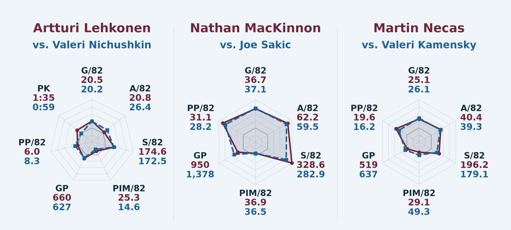
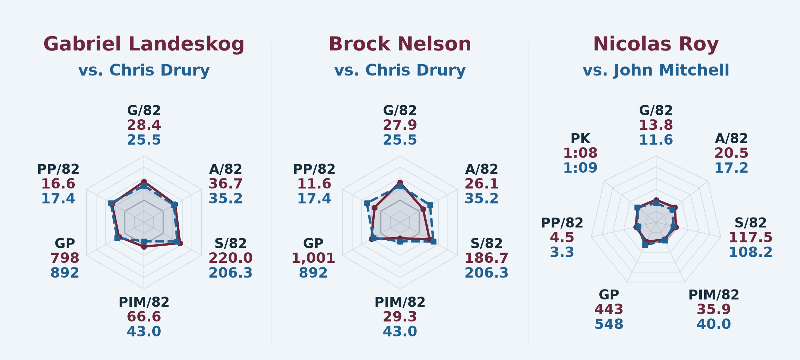
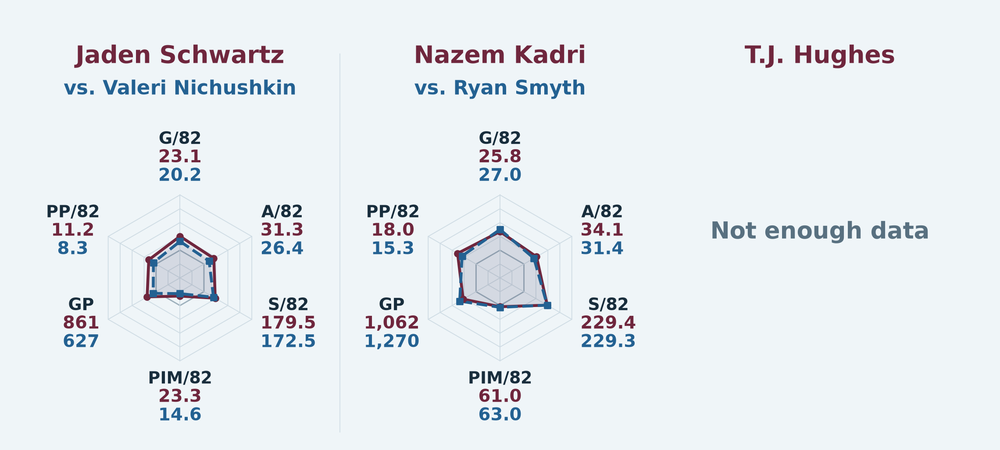
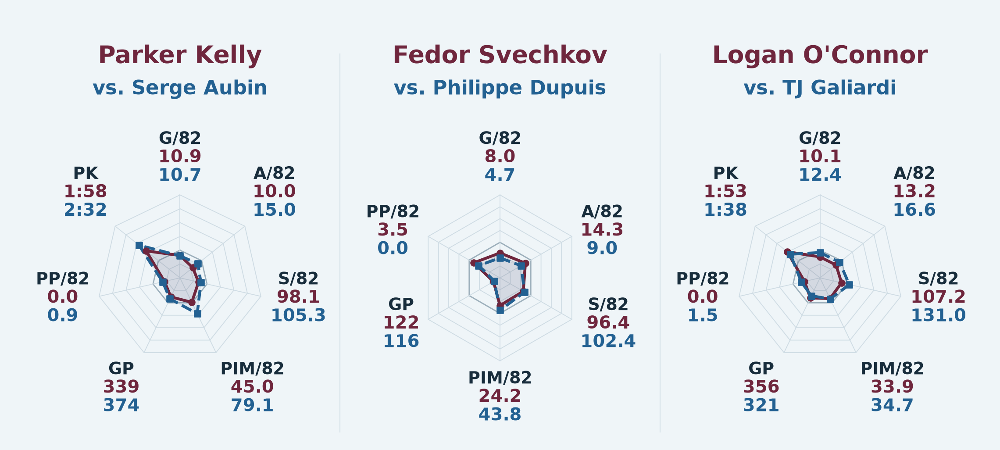
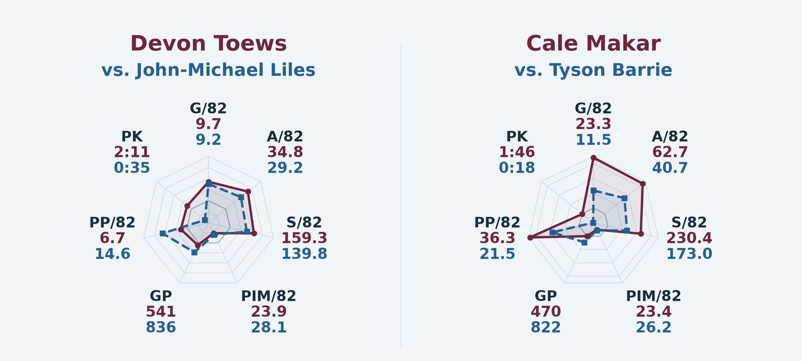
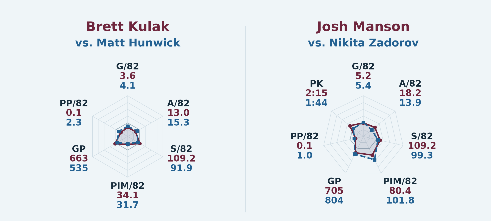
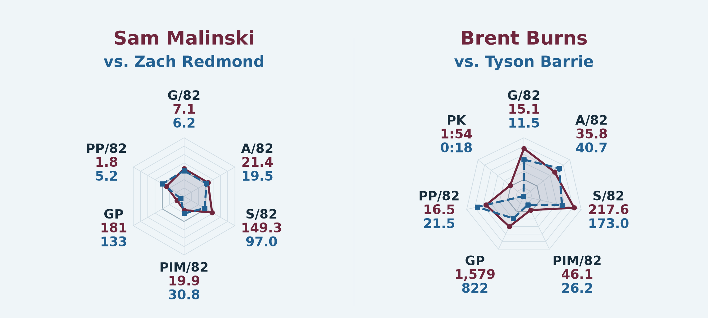
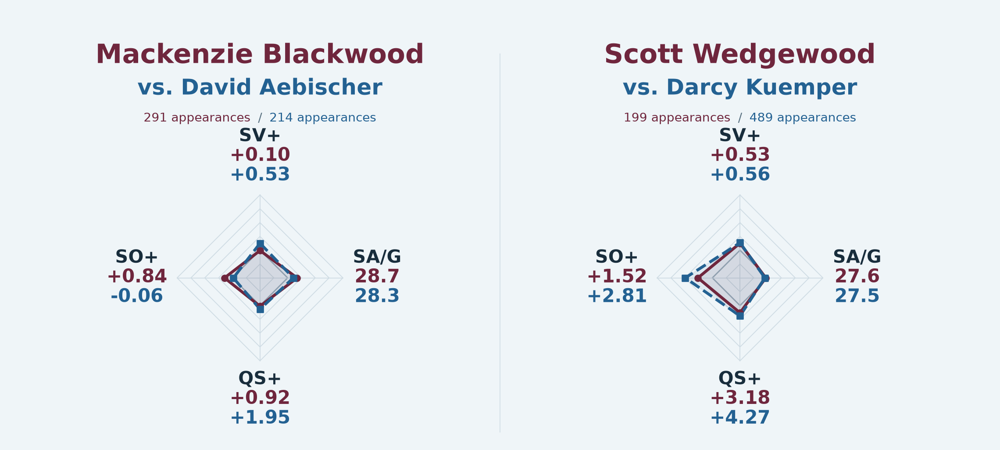
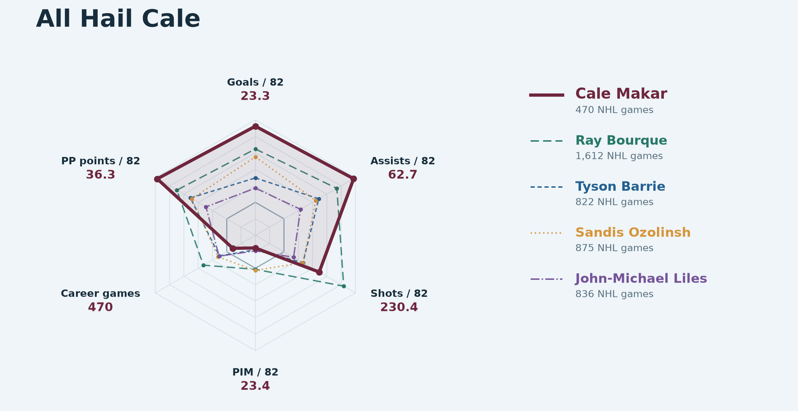
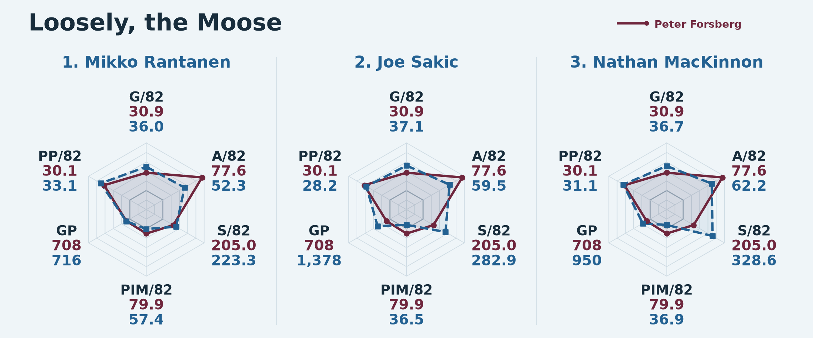

# Article figures

These are the final full-career figures, in article order.
Burgundy identifies the target player; blue identifies the named comparison in the roster
and Forsberg panels. The five-player Cale overlay names each color separately.

[Project and reproduction](../README.md) · [Method](../docs/methods.md) · [Figure checksums](manifest.json)

The separate age-adjusted supplement is generated by the same reproduction command.
PNG files are supplied here for GitHub viewing; the command also exports editable SVGs.

## Lehkonen · MacKinnon · Necas

## Landeskog · Nelson · Roy

## Schwartz · Kadri · Hughes

## Kelly · Svechkov · O’Connor

## Toews · Makar

## Kulak · Manson

## Malinski · Burns

## Blackwood · Wedgewood

## All Hail Cale

## Loosely, the Moose

